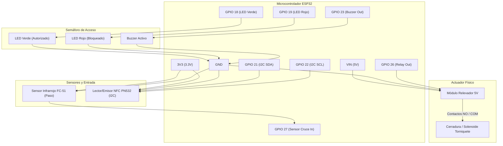

# Capa Física y Hardware IoT (Torniquete BUAP)

Este directorio contiene todo lo necesario para la construcción, simulación y conexionado del hardware del **Torniquete de Acceso Físico Inteligente**. 

El sistema admite dos formas de ejecución y prueba:
1. **Modo Gemelo Digital (Simulación en Python):** Mediante `simulador_torniquete.py`, útil para validar toda la mensajería MQTT y la lógica ZKP en la computadora sin cables.
2. **Modo Físico (Hardware Real con ESP32):** Mediante `esp32_torniquete.ino`, para armar el circuito real en protoboard con relevador, sensor de cruce y señalización.

---

## 1. Lista de Materiales (BOM)

Para armar el prototipo físico necesitarás los siguientes componentes:

| Componente | Función en el Proyecto | Voltaje de Operación |
| :--- | :--- | :--- |
| **ESP32 NodeMCU (30 o 38 pines)** | Microcontrolador central con Wi-Fi y cliente MQTT | 3.3V / 5V (vía USB) |
| **Módulo Relevador 5V (1 canal con optoacoplador)** | Disparo y apertura física del electroimán/cerradura del torniquete | 5V (VCC), Control 3.3V/5V |
| **Sensor Infrarrojo de Obstáculo (FC-51)** | Detección de paso de la persona (mecanismo anti-tailgating) | 3.3V - 5V |
| **Lector/Grabador NFC PN532 (Módulo I2C)** | Emisión de Deep Links NDEF / Lectura de tap móvil | 3.3V - 5V |
| **LED Verde (5mm)** | Indicador visual de acceso autorizado | 2.0V - 3.0V |
| **LED Rojo (5mm)** | Indicador visual de acceso bloqueado / en espera | 1.8V - 2.2V |
| **2x Resistencias de 220Ω o 330Ω** | Protección de corriente para los LEDs | - |
| **Buzzer Activo (Zumbador)** | Feedback sonoro de confirmación de acceso | 3.3V - 5V |
| **Protoboard y Cables Jumper** | Interconexión de componentes (M-M, M-H) | - |

---

## 2. Mapa de Conexiones (Pinout del ESP32)

| Componente | Pin del Componente | Pin en el ESP32 | Función / Descripción |
| :--- | :--- | :--- | :--- |
| **Módulo Relevador** | `VCC` | `VIN` (o 5V) | Alimentación de la bobina del relé |
| | `GND` | `GND` | Tierra común |
| | `IN` | **`GPIO 26`** | Señal de disparo (Activo a nivel LOW) |
| **LED Verde** | Ánodo (+) | **`GPIO 18`** (con resistencia de 220Ω) | Autorizado / Abierto |
| | Cátodo (-) | `GND` | Tierra común |
| **LED Rojo** | Ánodo (+) | **`GPIO 19`** (con resistencia de 220Ω) | Bloqueado / Cerrado |
| | Cátodo (-) | `GND` | Tierra común |
| **Buzzer Activo** | VCC / I/O (+) | **`GPIO 23`** | Beep de acceso concedido |
| | GND (-) | `GND` | Tierra común |
| **Sensor IR (FC-51)** | `VCC` | `3V3` o `VIN` | Alimentación del sensor |
| | `GND` | `GND` | Tierra común |
| | `OUT` / `D0` | **`GPIO 27`** | Salida digital (LOW al detectar cruce) |
| **Módulo NFC PN532** | `VCC` | `3V3` | Alimentación del chip NFC |
| *(Modo I2C: DIP switches 1=ON, 2=OFF)* | `GND` | `GND` | Tierra común |
| | `SDA` | **`GPIO 21`** | Bus de datos I2C |
| | `SCL` | **`GPIO 22`** | Bus de reloj I2C |

---

## 3. Diagrama Esquemático del Circuito



---

## 4. Guía Modular de Construcción (Paso a Paso)

Para garantizar que el circuito funcione a la primera sin errores de cableado o cortocircuitos, ármalo de forma modular probando cada etapa:

### Módulo 1: Conectividad Base y Wi-Fi (Solo ESP32)
1. Coloca el ESP32 en la protoboard.
2. Conecta el cable MicroUSB a tu computadora.
3. Abre el archivo [esp32_torniquete.ino](file:///home/daniel/Escritorio/Tesis%20Codigo/codigo/iot_hardware/esp32_torniquete.ino) en el **Arduino IDE** o **PlatformIO**.
4. Modifica las credenciales de red:
   ```cpp
   const char* WIFI_SSID = "Tu_Nombre_De_Red";
   const char* WIFI_PASSWORD = "Tu_Password";
   const char* MQTT_BROKER_IP = "IP_DE_TU_LAPTOP"; // ej. 192.168.1.15
   ```
5. Abre el Monitor Serie a `115200 baudios`.
6. Verifica que el ESP32 imprima:
   ```text
   [WiFi] Conectado exitosamente.
   [MQTT] Conectado! Suscrito a órdenes de apertura en: buap/torniquete/comandos
   ```

### Módulo 2: Relevador y Actuador de Apertura
1. Conecta:
   - `VCC` del Relevador $\rightarrow$ Pin `VIN` (5V) del ESP32.
   - `GND` del Relevador $\rightarrow$ Pin `GND` del ESP32.
   - `IN` del Relevador $\rightarrow$ Pin `GPIO 26` del ESP32.
2. Los bornes del torniquete o solenoide se conectan a los terminales **NO** (*Normally Open*) y **COM** (*Común*).
3. Cuando llegue un mensaje MQTT de apertura, escucharás el "clic" mecánico característico del relevador y su LED testigo encenderá.

### Módulo 3: Semáforo Visual (LEDs Verde / Rojo) y Buzzer
1. **LED Verde:**
   - Conecta el ánodo (pata larga) a una resistencia de 220Ω, y el otro extremo de la resistencia a `GPIO 18`.
   - Conecta el cátodo (pata corta) a la línea de tierra `GND`.
2. **LED Rojo:**
   - Conecta el ánodo a una resistencia de 220Ω, y el otro extremo a `GPIO 19`.
   - Conecta el cátodo a `GND`.
3. **Buzzer:**
   - Pin positivo (+) a `GPIO 23`.
   - Pin negativo (-) a `GND`.
4. **Comportamiento esperado:**
   - Reposo: LED Rojo encendido (bloqueado).
   - Acceso concedido: LED Rojo se apaga, LED Verde se enciende y el buzzer suena un "beep" de 150 ms.

### Módulo 4: Sensor Infrarrojo de Cruce (Anti-Tailgating)
1. Conecta el sensor FC-51:
   - `VCC` $\rightarrow$ `3V3` o `VIN`.
   - `GND` $\rightarrow$ `GND`.
   - `OUT` $\rightarrow$ `GPIO 27`.
2. Ajusta el potenciómetro azul del sensor con un desarmador pequeño hasta que el LED sensor se active solo cuando pases la mano a 15-30 cm de distancia.
3. **Comportamiento esperado:**
   - Cuando el relevador está abierto y una persona cruza el sensor, el ESP32 detecta el corte en `GPIO 27`, bloquea el relevador de inmediato (`🟢 -> 🔴`) y emite el paquete de telemetría por MQTT.

### Módulo 5: Lector/Emisor NFC PN532
1. Coloca los micro-interruptores (DIP switch) del PN532 en modo **I2C**:
   - `CH1`: **ON**
   - `CH2`: **OFF**
2. Conecta:
   - `VCC` $\rightarrow$ `3V3`
   - `GND` $\rightarrow$ `GND`
   - `SDA` $\rightarrow$ `GPIO 21`
   - `SCL` $\rightarrow$ `GPIO 22`
3. El PN532 emite el enlace Out-of-Band (OOB) o lee el DID del teléfono al realizar el *Tap*.

---

## 5. Especificación del Protocolo MQTT

El microcontrolador y el servidor de borde (FastAPI Verificador) se comunican mediante JSON estructurado a través de dos topics:

### 1. Topic de Comandos (`buap/torniquete/comandos`)
- **Emisor:** FastAPI Verificador (tras validar la prueba matemática ZKP en ACA-Py).
- **Receptor:** ESP32.
- **Payload:**
  ```json
  {
    "accion": "abrir",
    "pres_ex_id": "038cf56e-8e54-47b2-a421-a3f2b6781290"
  }
  ```

### 2. Topic de Telemetría (`buap/torniquete/telemetria`)
- **Emisor:** ESP32 (al detectar que la persona cruzó el haz infrarrojo).
- **Receptor:** Verificador / Sistema de Monitoreo.
- **Payload:**
  ```json
  {
    "evento": "cruce_exitoso",
    "timestamp": 1731980000,
    "status": "cerrado"
  }
  ```

---

## 6. Pruebas sin Hardware Físico (Gemelo Digital)

Si estás trabajando en la laptop y no tienes los componentes físicos a mano, puedes ejecutar exactamente la misma lógica mediante el simulador en Python:

```bash
cd "/home/daniel/Escritorio/Tesis Codigo/codigo/iot_hardware"
pip install -r requirements.txt
python simulador_torniquete.py
```

El script se conecta a Mosquitto en `localhost:1883`, escucha en `buap/torniquete/comandos` e imprime en consola el accionamiento del relevador y la telemetría de cruce.
