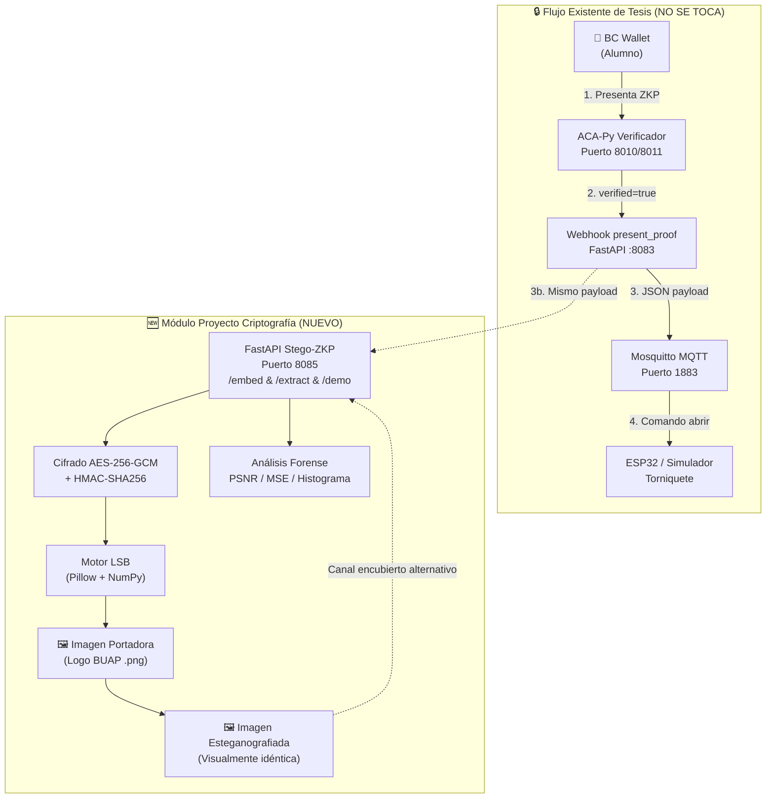

# Estrategia del Proyecto Final de Criptografía
## Integración de Pruebas de Conocimiento Cero (ZKP) + Esteganografía sobre Arquitectura SSI-IoT

> **Materia:** Criptografía
> **Fecha de Entrega / Presentación:** 10 de diciembre de 2026
> **Alumno:** Daniel
> **Requisito:** Proyecto que combine Criptografía + Esteganografía

---

## 1. Visión Estratégica: ¿Por qué esto funciona como proyecto final?

La profesora pidió un proyecto que combine **criptografía** con **esteganografía**. En lugar de crear algo desde cero y perder tiempo, vamos a **demostrar ambos conceptos directamente sobre la arquitectura de tesis** que ya tenemos funcionando. Esto nos da un triple beneficio:

1. **Cumplimos la materia** con un proyecto técnicamente sólido y original.
2. **Avanzamos la tesis** agregando una capa de seguridad real (defensa en profundidad).
3. **Presentamos avance el 10 de diciembre** con un módulo funcional que fortalece la demostración.

### ¿Qué se presenta a la profesora?
Un sistema real donde:
- **Criptografía (ZKP):** Un alumno demuestra que tiene derecho de acceso a un edificio universitario *sin revelar su identidad ni datos personales* usando Pruebas de Conocimiento Cero del ecosistema Hyperledger Indy/AnonCreds — ya implementado en la tesis.
- **Esteganografía (Canal Encubierto):** La orden de "abrir el torniquete" (resultado de la verificación ZKP) se oculta dentro de una imagen institucional en lugar de enviarse como un JSON plano por MQTT. Un atacante que intercepte el tráfico de red solo ve una imagen PNG inocua, no un comando de control.

---

## 2. Análisis de Opciones → Decisión Técnica

La propuesta original planteaba dos opciones. Aquí analizamos cuál conviene implementar:

| Criterio | Opción A: Esteganografía en Imagen (LSB) | Opción B: Esteganografía en Telemetría MQTT |
|:---|:---|:---|
| **Dificultad de implementación** | ⭐ Baja-Media (librerías maduras) | ⭐⭐⭐ Alta (protocolo custom) |
| **Impacto visual en demo** | ✅ Excelente — se puede "mostrar" la imagen antes/después, calcular PSNR | ⚠️ Difícil de visualizar |
| **Cobertura de conceptos de la materia** | ✅ AES-GCM + LSB + HMAC + Análisis estadístico | ✅ Pero más abstracto |
| **Reutilización con tesis** | ✅ Se conecta al webhook existente | ✅ Pero requiere cambiar protocolo ESP32 |
| **Tiempo estimado** | 3-4 días de desarrollo | 7-10 días |
| **Riesgo de romper algo** | 🟢 Bajo (módulo aislado) | 🔴 Alto (modifica flujo MQTT existente) |

### ✅ DECISIÓN: Opción A — Esteganografía en Imagen (LSB + AES-256-GCM)

**Justificación:** Es la opción que maximiza el impacto en la presentación (la profesora puede VER la diferencia), cubre todos los conceptos de la materia, y se implementa como un módulo 100% independiente que no toca el código existente de la tesis.

---

## 3. Arquitectura del Módulo (Lo que se va a construir)



> [!IMPORTANT]
> El módulo nuevo corre en un **contenedor Docker independiente** en el puerto `8085`. **No modifica** ningún archivo existente del proyecto de tesis. Es puramente aditivo.

---

## 4. Conceptos Criptográficos Cubiertos (Para la materia)

Este proyecto demuestra dominio de los siguientes temas del temario de Criptografía:

### 4.1 Pruebas de Conocimiento Cero (ZKP)
- **Protocolo:** AnonCreds sobre Hyperledger Indy.
- **Propiedades demostradas:** Completitud, Solidez, Conocimiento Cero.
- **Ejemplo concreto:** El alumno demuestra que `tipo_suscripcion == "estudiante"` sin revelar nombre, matrícula ni facultad.
- **Primitiva subyacente:** Firmas CL (Camenisch-Lysyanskaya) con compromisos Pedersen.

### 4.2 Cifrado Simétrico Autenticado (AES-256-GCM)
- **Algoritmo:** AES en modo Galois/Counter Mode (256 bits).
- **Propiedades:** Confidencialidad + Integridad + Autenticación (AEAD).
- **Uso:** Cifrar el payload de autorización antes de ocultarlo en la imagen.
- **Nonce/IV:** 96 bits generado con `os.urandom()` para cada operación.

### 4.3 Derivación de Llaves (HKDF)
- **Algoritmo:** HKDF-SHA256 (HMAC-based Key Derivation Function).
- **Uso:** Derivar la llave AES a partir de un secreto compartido entre el Verificador y el módulo esteganográfico.

### 4.4 Integridad y Autenticación de Mensajes (HMAC)
- **Algoritmo:** HMAC-SHA256.
- **Uso:** Verificar que el payload extraído no fue manipulado en tránsito.

### 4.5 Esteganografía Digital (LSB — Bit Menos Significativo)
- **Técnica:** Sustitución de los bits menos significativos de los canales RGB de la imagen portadora.
- **Formato:** PNG (sin pérdida), garantizando preservación exacta de los bits ocultos.
- **Capacidad:** Para una imagen de 500×500 px: `500 × 500 × 3 canales × 1 bit = 93,750 bytes` de payload oculto.
- **Métricas de calidad:**
  - **PSNR (Peak Signal-to-Noise Ratio):** Se espera > 50 dB (imperceptible al ojo humano).
  - **MSE (Mean Squared Error):** Se espera < 0.5.
  - **Comparación de histogramas:** Canal por canal (R, G, B) antes y después.

---

## 5. Estructura de Archivos del Módulo Nuevo

```
proyecto_final_criptografia/
├── ESTRATEGIA_ZKP_ESTEGANOGRAFIA.md        ← Este documento
├── WALKTHROUGH_CRIPTOGRAFIA.md             ← Guía paso a paso de ejecución
├── docker-compose.stego.yml                ← Compose independiente (puerto 8085)
├── Dockerfile                              ← Imagen Docker del módulo
├── requirements.txt                        ← Dependencias Python
├── app/
│   ├── __init__.py
│   ├── main.py                             ← FastAPI principal del módulo
│   ├── routers/
│   │   ├── __init__.py
│   │   ├── stego_zkp.py                    ← Endpoints: /embed, /extract, /demo
│   │   └── analysis.py                     ← Endpoints: /psnr, /compare, /histogram
│   ├── services/
│   │   ├── __init__.py
│   │   ├── crypto_service.py               ← AES-256-GCM + HKDF + HMAC
│   │   └── steganography_service.py        ← Motor LSB (Pillow + NumPy)
│   └── core/
│       ├── __init__.py
│       └── config.py                       ← Configuración y secretos
├── assets/
│   └── portadora_buap.png                  ← Imagen portadora institucional
├── tests/
│   ├── test_crypto.py                      ← Tests unitarios de cifrado
│   ├── test_steganography.py               ← Tests unitarios de LSB
│   └── test_integration.py                 ← Test end-to-end embed→extract
└── notebooks/
    └── demo_visual.ipynb                   ← Notebook Jupyter para la presentación
```

> [!NOTE]
> Todo el módulo vive dentro de `proyecto_final_criptografia/` como un submódulo autocontenido. No tiene dependencias de los contenedores de la tesis para funcionar en modo demo.

---

## 6. Endpoints de la API Stego-ZKP

### 6.1 `POST /stego-zkp/embed`
**Descripción:** Recibe un payload de autorización (simula el resultado de una ZKP exitosa), lo cifra con AES-256-GCM y lo oculta en la imagen portadora usando LSB.

**Request Body:**
```json
{
  "payload": {
    "proof_id": "v2-abc123",
    "status": "VERIFIED",
    "timestamp": 1733800000,
    "nonce": "randomnonce123",
    "alumno_autorizado": true
  },
  "password": "clave-compartida-verificador"
}
```

**Response:**
```json
{
  "message": "Payload cifrado e incrustado exitosamente",
  "imagen_original": "/assets/portadora_buap.png",
  "imagen_stego": "/output/stego_1733800000.png",
  "payload_size_bytes": 142,
  "capacidad_imagen_bytes": 93750,
  "uso_capacidad_pct": 0.15
}
```

### 6.2 `POST /stego-zkp/extract`
**Descripción:** Recibe una imagen esteganografiada, extrae los bits ocultos, descifra con AES-256-GCM y devuelve el payload original.

**Request Body:** `multipart/form-data` con la imagen y la contraseña.

**Response:**
```json
{
  "message": "Payload extraído y descifrado correctamente",
  "payload": {
    "proof_id": "v2-abc123",
    "status": "VERIFIED",
    "timestamp": 1733800000,
    "nonce": "randomnonce123",
    "alumno_autorizado": true
  },
  "integridad_hmac": "VÁLIDA",
  "timestamp_verificacion": 1733800005
}
```

### 6.3 `GET /stego-zkp/demo`
**Descripción:** Ejecuta el flujo completo automáticamente (embed → extract) con un payload de prueba y devuelve las métricas forenses para la presentación.

**Response:**
```json
{
  "demo_exitosa": true,
  "payload_original": { "..." },
  "payload_recuperado": { "..." },
  "coincidencia_exacta": true,
  "metricas": {
    "psnr_db": 57.23,
    "mse": 0.12,
    "ssim": 0.9998,
    "bits_modificados": 1136,
    "bits_totales": 750000
  }
}
```

### 6.4 `POST /analysis/compare`
**Descripción:** Compara la imagen original vs. la esteganografiada y genera histogramas por canal RGB.

### 6.5 `POST /analysis/forensic-report`
**Descripción:** Genera un reporte PDF/JSON con todas las métricas de calidad para adjuntar al entregable.

---

## 7. Flujo Narrativo para la Presentación (Guion sugerido)

### Acto 1: "El Problema" (2 min)
> *"En un sistema de control de acceso físico, si un atacante intercepta el tráfico de red (man-in-the-middle), puede ver los comandos JSON de apertura. Aunque usemos ZKP para verificar la identidad, el canal de comando es visible."*

### Acto 2: "La Criptografía — ZKP" (5 min)
> Demostrar en vivo con BC Wallet cómo el alumno prueba su identidad sin revelar datos.
> Mostrar el webhook del Verificador imprimiendo `verified=True`.

### Acto 3: "La Esteganografía — Canal Encubierto" (5 min)
> Mostrar la imagen original del logo BUAP.
> Ejecutar `POST /stego-zkp/embed` con el payload de la ZKP.
> Mostrar la imagen resultante: *"¿Ven alguna diferencia? Exacto, no la hay."*
> Mostrar las métricas PSNR > 50 dB.
> Ejecutar `POST /stego-zkp/extract` y recuperar el payload: *"Pero la orden de abrir el torniquete está ahí dentro."*

### Acto 4: "Análisis Forense" (3 min)
> Mostrar histogramas RGB superpuestos (original vs. stego).
> Mostrar que sin la llave AES-GCM, los bits extraídos son basura aleatoria.

### Acto 5: "Integración con la Tesis" (2 min)
> Diagrama de cómo esto se conecta con el flujo real del torniquete y el ESP32.
> *"Este módulo añade una capa de defensa en profundidad: incluso si el atacante captura el paquete, solo ve una imagen."*

---

## 8. Dependencias de Python del Módulo

```
fastapi==0.115.6
uvicorn[standard]==0.34.0
cryptography==44.0.0        # AES-256-GCM, HKDF, HMAC
Pillow==11.1.0              # Manipulación de imágenes PNG
numpy==2.2.1                # Operaciones matriciales LSB
scikit-image==0.25.0        # PSNR, SSIM (métricas)
paho-mqtt==2.1.0            # Comunicación con Mosquitto (opcional)
python-multipart==0.0.20    # Upload de imágenes en FastAPI
pytest==8.3.4               # Testing
```

---

## 9. Cronograma Sugerido (Antes del 10 de diciembre)

| Semana | Días | Actividad | Entregable |
|:---|:---|:---|:---|
| **Semana 1** | Nov 19-23 | Implementar `crypto_service.py` (AES-GCM, HKDF) y `steganography_service.py` (LSB embed/extract) | Tests unitarios pasando |
| **Semana 1** | Nov 24-25 | Implementar endpoints FastAPI y `docker-compose.stego.yml` | API funcional en `localhost:8085/docs` |
| **Semana 2** | Nov 26-29 | Implementar análisis forense (PSNR, MSE, histogramas) y endpoint `/demo` | Métricas calculándose correctamente |
| **Semana 2** | Nov 30-Dic 1 | Crear notebook `demo_visual.ipynb` para la presentación | Notebook con visualizaciones |
| **Semana 3** | Dic 2-5 | Integración con webhook del Verificador (prueba end-to-end opcional) | Demo completa corriendo |
| **Semana 3** | Dic 6-9 | Preparar presentación, documentación y ensayo | Listo para presentar el 10 |

> [!TIP]
> Las semanas 1 y 2 son el core del proyecto de criptografía. La semana 3 es para pulir y conectar con la tesis. Si el tiempo aprieta, el módulo funciona de forma independiente para la materia.

---

## 10. Riesgos y Mitigaciones

| Riesgo | Probabilidad | Mitigación |
|:---|:---|:---|
| No alcanza el tiempo | Media | El módulo es 100% independiente. Se puede presentar solo con los endpoints `/embed`, `/extract` y `/demo` sin necesitar la infraestructura de tesis corriendo |
| La profesora pregunta por robustez del LSB | Baja | Preparar respuesta sobre ataques de esteganálisis (chi-square, RS analysis) y mencionar que para producción se usaría DCT o F5 |
| Conflicto de puertos con la tesis | Muy Baja | El módulo usa el puerto `8085`, que no colisiona con ningún servicio existente (8082, 8083, 8000, 8001, 8010, 8011) |
| Pérdida de bits por formato de imagen | Nula | Usamos PNG (sin pérdida). Nunca JPEG para LSB |

---

## 11. Valor Agregado para la Tesis

Este módulo no es "trabajo perdido" — se puede presentar al comité tutorial como:

- **Capa de Seguridad #3: Canal Encubierto (Covert Channel)** dentro de la arquitectura de defensa en profundidad.
- **Contribución original:** Combinación de ZKP + esteganografía en contexto IoT/Edge — hay pocos trabajos que combinen ambos.
- **Publicación potencial:** El análisis de métricas (PSNR, MSE, throughput) sobre payloads de autorización SSI ocultos en imágenes tiene valor para un artículo corto.

---

> **Próximo paso:** Lee el archivo `WALKTHROUGH_CRIPTOGRAFIA.md` para la guía paso a paso de cómo construir, ejecutar y demostrar este módulo.
