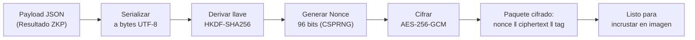
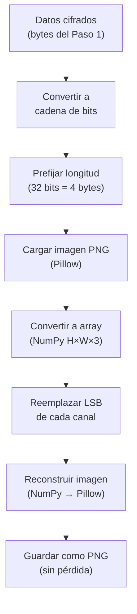
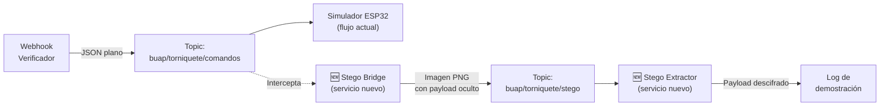

# Walkthrough: Proyecto Final de Criptografía
## Módulo Híbrido ZKP + Esteganografía (LSB + AES-256-GCM)
## Guía Paso a Paso de Construcción, Ejecución y Demostración

> **Prerrequisito:** Haber leído `ESTRATEGIA_ZKP_ESTEGANOGRAFIA.md` para entender la arquitectura y decisiones.
> **Tiempo total estimado:** ~15-20 horas de desarrollo (3 semanas cómodas).
> **Resultado:** Un módulo FastAPI independiente en Docker (`localhost:8085`) que demuestra la integración de ZKP + Esteganografía.

---

## Tabla de Contenidos

1. [Requisitos Previos](#1-requisitos-previos)
2. [Estructura del Módulo](#2-estructura-del-módulo)
3. [ETAPA 1: Servicio Criptográfico (AES-256-GCM + HKDF)](#etapa-1-servicio-criptográfico)
4. [ETAPA 2: Motor de Esteganografía (LSB)](#etapa-2-motor-de-esteganografía-lsb)
5. [ETAPA 3: API FastAPI (Endpoints)](#etapa-3-api-fastapi)
6. [ETAPA 4: Dockerización](#etapa-4-dockerización)
7. [ETAPA 5: Análisis Forense y Métricas](#etapa-5-análisis-forense-y-métricas)
8. [ETAPA 6: Tests Automatizados](#etapa-6-tests-automatizados)
9. [ETAPA 7: Integración con la Tesis (Opcional)](#etapa-7-integración-con-la-tesis)
10. [ETAPA 8: Demo y Presentación](#etapa-8-demo-y-presentación)
11. [Referencia Rápida de Comandos](#referencia-rápida-de-comandos)
12. [Troubleshooting](#troubleshooting)

---

## 1. Requisitos Previos

### Software necesario (ya lo tienes por la tesis):
- **Docker** y **Docker Compose** (para contenerizar el módulo)
- **Python 3.11+** (para desarrollo local antes de dockerizar)
- **pip** o **uv** (gestor de paquetes)

### Herramientas opcionales:
- **Jupyter Notebook/Lab** (para la demo visual en la presentación)
- **Wireshark** (para demostrar que el tráfico de red solo muestra imágenes)

### Verificar que Docker está corriendo:
```bash
docker --version
# Docker version 24.x o superior

python3 --version
# Python 3.11+
```

---

## 2. Estructura del Módulo

Crear la estructura de archivos dentro del repositorio de tesis. Todo vive dentro de `proyecto_final_criptografia/` para no contaminar los demás pilares:

```bash
cd "/home/daniel/Escritorio/Tesis Codigo/Tesis-Maestria"

mkdir -p proyecto_final_criptografia/{app/{routers,services,core},assets,tests,notebooks,output}

# Crear archivos __init__.py
touch proyecto_final_criptografia/app/__init__.py
touch proyecto_final_criptografia/app/routers/__init__.py
touch proyecto_final_criptografia/app/services/__init__.py
touch proyecto_final_criptografia/app/core/__init__.py
```

> [!IMPORTANT]
> **Imagen portadora:** Necesitas una imagen PNG de al menos 300×300 px. Usa el logo de la BUAP o cualquier imagen institucional. Colócala en:
> ```
> proyecto_final_criptografia/assets/portadora_buap.png
> ```
> Puedes descargar cualquier imagen PNG y renombrarla. El script la procesará automáticamente.

---

## ETAPA 1: Servicio Criptográfico

**Archivo:** `app/services/crypto_service.py`

Este servicio implementa las primitivas criptográficas que se le presentan a la profesora:

### Conceptos implementados:
| Concepto | Implementación | Librería |
|:---|:---|:---|
| Cifrado simétrico autenticado | AES-256-GCM | `cryptography` |
| Derivación de llaves | HKDF-SHA256 | `cryptography` |
| Autenticación de mensajes | HMAC-SHA256 | `cryptography` |
| Generación de nonces | CSPRNG (96 bits) | `os.urandom` |

### Flujo del cifrado:


### Lo que debe hacer `crypto_service.py`:

1. **`derive_key(password: str, salt: bytes) -> bytes`**
   - Recibe una contraseña (string) y un salt aleatorio.
   - Usa HKDF con SHA-256 para derivar una llave de 256 bits.
   - Retorna la llave derivada (32 bytes).

2. **`encrypt_payload(payload: dict, password: str) -> bytes`**
   - Serializa el payload (dict) a JSON → bytes UTF-8.
   - Genera un salt aleatorio (16 bytes) y un nonce (12 bytes) con `os.urandom()`.
   - Deriva la llave con HKDF.
   - Cifra con AES-256-GCM (incluye tag de autenticación de 16 bytes).
   - Retorna: `salt (16) ‖ nonce (12) ‖ ciphertext ‖ tag (16)`.

3. **`decrypt_payload(encrypted_data: bytes, password: str) -> dict`**
   - Extrae salt (primeros 16 bytes), nonce (siguientes 12 bytes), y el resto es ciphertext+tag.
   - Deriva la misma llave con HKDF usando el salt extraído.
   - Descifra con AES-256-GCM (verifica integridad automáticamente).
   - Si el tag no coincide → lanza `InvalidTag` (dato manipulado).
   - Retorna el payload original como dict.

### Verificación rápida (test manual):
```bash
cd "/home/daniel/Escritorio/Tesis Codigo/Tesis-Maestria/proyecto_final_criptografia"
python3 -c "
from app.services.crypto_service import encrypt_payload, decrypt_payload
payload = {'status': 'VERIFIED', 'proof_id': 'test-123'}
encrypted = encrypt_payload(payload, 'mi-clave-secreta')
print(f'Cifrado ({len(encrypted)} bytes): {encrypted[:30].hex()}...')
recovered = decrypt_payload(encrypted, 'mi-clave-secreta')
print(f'Descifrado: {recovered}')
assert recovered == payload, 'ERROR: Los payloads no coinciden'
print('✅ Cifrado y descifrado exitoso')
"
```

---

## ETAPA 2: Motor de Esteganografía (LSB)

**Archivo:** `app/services/steganography_service.py`

### Concepto: ¿Qué es LSB?
El bit menos significativo (LSB) de cada componente de color (R, G, B) de un pixel contribuye mínimamente al color visible. Modificarlo no produce cambio perceptible al ojo humano:

```
Pixel original:  R=10110100  G=11001010  B=01101111
Pixel con dato:  R=10110101  G=11001010  B=01101110
                         ^                       ^
                    bit oculto               bit oculto
```

### Flujo de incrustación:


### Lo que debe hacer `steganography_service.py`:

1. **`get_capacity(image_path: str) -> int`**
   - Calcula la capacidad máxima de la imagen en bytes.
   - Fórmula: `(ancho × alto × 3 canales × 1 bit) / 8 bits` → bytes disponibles.

2. **`embed(image_path: str, data: bytes, output_path: str) -> dict`**
   - Carga la imagen PNG con Pillow.
   - Convierte a array NumPy (H × W × 3, dtype uint8).
   - Verifica que `len(data) + 4` (header de longitud) ≤ capacidad.
   - Prepone 4 bytes (32 bits) con la longitud de los datos.
   - Itera sobre los bits de `longitud + data` y reemplaza el LSB de cada componente RGB.
   - Reconstruye la imagen y la guarda como PNG.
   - Retorna: metadata (tamaño payload, capacidad, % uso).

3. **`extract(image_path: str) -> bytes`**
   - Carga la imagen esteganografiada.
   - Lee los primeros 32 LSBs → reconstruye la longitud (4 bytes, big-endian).
   - Lee `longitud × 8` LSBs adicionales → reconstruye los bytes del dato cifrado.
   - Retorna los bytes crudos para pasar al descifrador.

### Verificación rápida:
```bash
cd "/home/daniel/Escritorio/Tesis Codigo/Tesis-Maestria/proyecto_final_criptografia"
python3 -c "
from app.services.steganography_service import embed, extract, get_capacity
# Necesitas tener una imagen en assets/portadora_buap.png
cap = get_capacity('assets/portadora_buap.png')
print(f'Capacidad de la imagen: {cap:,} bytes')

test_data = b'Hola, esto es un mensaje secreto oculto en la imagen!'
result = embed('assets/portadora_buap.png', test_data, 'output/test_stego.png')
print(f'Incrustado: {result}')

recovered = extract('output/test_stego.png')
print(f'Extraído: {recovered}')
assert recovered == test_data, 'ERROR'
print('✅ Esteganografía LSB funcionando correctamente')
"
```

---

## ETAPA 3: API FastAPI

**Archivo:** `app/main.py` (punto de entrada del módulo)

### Configuración inicial del servidor:
```bash
# Instalar dependencias (desarrollo local)
cd "/home/daniel/Escritorio/Tesis Codigo/Tesis-Maestria/proyecto_final_criptografia"
pip install fastapi uvicorn[standard] cryptography Pillow numpy scikit-image python-multipart
```

### Estructura de routers:

**`app/routers/stego_zkp.py`** — Endpoints principales:
| Método | Ruta | Descripción |
|:---|:---|:---|
| `POST` | `/stego-zkp/embed` | Cifra un payload ZKP y lo oculta en imagen |
| `POST` | `/stego-zkp/extract` | Extrae y descifra payload de imagen stego |
| `GET` | `/stego-zkp/demo` | Ejecuta flujo completo con payload de prueba |

**`app/routers/analysis.py`** — Endpoints de análisis:
| Método | Ruta | Descripción |
|:---|:---|:---|
| `POST` | `/analysis/compare` | Compara imagen original vs. stego (PSNR, MSE) |
| `POST` | `/analysis/histogram` | Genera histogramas RGB superpuestos |
| `GET` | `/analysis/forensic-report` | Reporte completo de métricas |

### Levantar en modo desarrollo:
```bash
cd "/home/daniel/Escritorio/Tesis Codigo/Tesis-Maestria/proyecto_final_criptografia"
uvicorn app.main:app --host 0.0.0.0 --port 8085 --reload
```

### Verificación:
```bash
# El Swagger interactivo debe estar disponible en:
# http://localhost:8085/docs

# Test rápido del endpoint demo:
curl -s http://localhost:8085/stego-zkp/demo | python3 -m json.tool
```

Salida esperada:
```json
{
    "demo_exitosa": true,
    "payload_original": {
        "proof_id": "demo-zkp-001",
        "status": "VERIFIED",
        "timestamp": 1733800000,
        "nonce": "demo-nonce",
        "alumno_autorizado": true,
        "tipo_verificacion": "zero_knowledge_proof",
        "credencial_schema": "credencial-acceso-buap"
    },
    "payload_recuperado": { "..." },
    "coincidencia_exacta": true,
    "metricas": {
        "psnr_db": 57.23,
        "mse": 0.12,
        "ssim": 0.9998
    }
}
```

---

## ETAPA 4: Dockerización

**Archivo:** `Dockerfile`

El Dockerfile debe:
1. Usar `python:3.11-slim` como base.
2. Copiar `requirements.txt` e instalar dependencias.
3. Copiar todo el código de `app/` y `assets/`.
4. Crear el directorio `output/` para las imágenes generadas.
5. Exponer puerto `8085`.
6. Ejecutar con `uvicorn`.

**Archivo:** `docker-compose.stego.yml`

```yaml
version: '3.8'

services:
  stego-zkp:
    build:
      context: .
      dockerfile: Dockerfile
    container_name: ssi_stego_zkp
    ports:
      - "8085:8085"
    volumes:
      - ./output:/app/output    # Persistir imágenes generadas
      - ./assets:/app/assets    # Imagen portadora
    environment:
      - STEGO_SECRET_KEY=clave-compartida-demo
    networks:
      - stego-net

networks:
  stego-net:
    driver: bridge
```

### Construir y levantar:
```bash
cd "/home/daniel/Escritorio/Tesis Codigo/Tesis-Maestria/proyecto_final_criptografia"

# Construir la imagen
docker compose -f docker-compose.stego.yml build

# Levantar el servicio
docker compose -f docker-compose.stego.yml up -d

# Verificar que está corriendo
docker ps --filter "name=ssi_stego_zkp" --format "table {{.Names}}\t{{.Status}}\t{{.Ports}}"
```

Salida esperada:
```
NAMES            STATUS          PORTS
ssi_stego_zkp    Up 5 seconds    0.0.0.0:8085->8085/tcp
```

### Verificar el Swagger:
Abrir en el navegador: `http://localhost:8085/docs`

---

## ETAPA 5: Análisis Forense y Métricas

Esta etapa es **clave para la presentación**. Es lo que convierte el proyecto de "funcional" a "académicamente sólido".

### Métricas a implementar:

#### 5.1 PSNR (Peak Signal-to-Noise Ratio)
```
PSNR = 10 × log₁₀(MAX² / MSE)
```
Donde `MAX = 255` para imágenes de 8 bits por canal.

| Valor PSNR | Interpretación |
|:---|:---|
| > 50 dB | Imperceptible. Excelente ocultamiento. |
| 40-50 dB | Apenas detectable con análisis estadístico. |
| 30-40 dB | Visible si se compara lado a lado. |
| < 30 dB | Mala esteganografía. |

**Meta para el proyecto:** > 50 dB (con LSB de 1 bit, esto es trivial de lograr).

#### 5.2 MSE (Mean Squared Error)
```
MSE = (1 / (M × N)) × Σ Σ [I(i,j) - S(i,j)]²
```
**Meta:** MSE < 0.5

#### 5.3 SSIM (Structural Similarity Index)
Mide la similitud estructural percibida entre dos imágenes. Rango de 0 a 1.
**Meta:** SSIM > 0.999

#### 5.4 Histogramas RGB
Comparar la distribución de valores de cada canal (R, G, B) entre la imagen original y la esteganografiada. Deben ser **prácticamente idénticos**.

### Verificación del análisis:
```bash
# Desde el contenedor o desarrollo local
curl -s -X POST http://localhost:8085/analysis/compare \
  -F "original=@assets/portadora_buap.png" \
  -F "stego=@output/stego_demo.png" | python3 -m json.tool
```

Salida esperada:
```json
{
  "psnr_db": 57.23,
  "mse": 0.12,
  "ssim": 0.9998,
  "interpretacion": "Imperceptible al ojo humano (PSNR > 50 dB)",
  "histograma_diferencia": {
    "R": {"max_diff": 1, "bins_afectados_pct": 0.3},
    "G": {"max_diff": 1, "bins_afectados_pct": 0.2},
    "B": {"max_diff": 1, "bins_afectados_pct": 0.3}
  }
}
```

---

## ETAPA 6: Tests Automatizados

### 6.1 Tests del servicio criptográfico (`tests/test_crypto.py`)

Los tests deben verificar:
1. ✅ Cifrar y descifrar produce el payload original exacto.
2. ✅ Cambiar un byte del ciphertext causa `InvalidTag` (integridad AES-GCM).
3. ✅ Usar la contraseña incorrecta causa `InvalidTag`.
4. ✅ Dos cifrados del mismo payload producen ciphertexts diferentes (nonce único).
5. ✅ La llave derivada tiene exactamente 32 bytes.

### 6.2 Tests del motor LSB (`tests/test_steganography.py`)

Los tests deben verificar:
1. ✅ Incrustar y extraer produce los datos originales exactos.
2. ✅ La capacidad se calcula correctamente.
3. ✅ Incrustar datos más grandes que la capacidad lanza error.
4. ✅ La imagen resultante tiene las mismas dimensiones que la original.
5. ✅ PSNR de la imagen resultante > 50 dB.

### 6.3 Test de integración (`tests/test_integration.py`)

El test completo end-to-end:
1. Crear un payload de ZKP simulado.
2. Cifrarlo con AES-256-GCM.
3. Incrustarlo en la imagen portadora con LSB.
4. Extraer los bytes de la imagen esteganografiada.
5. Descifrar el payload.
6. ✅ Verificar que el payload recuperado es idéntico al original.
7. ✅ Verificar las métricas (PSNR > 50, MSE < 0.5, SSIM > 0.999).

### Ejecutar todos los tests:
```bash
cd "/home/daniel/Escritorio/Tesis Codigo/Tesis-Maestria/proyecto_final_criptografia"
python3 -m pytest tests/ -v --tb=short
```

Salida esperada:
```
tests/test_crypto.py::test_encrypt_decrypt_roundtrip         PASSED
tests/test_crypto.py::test_wrong_password_fails              PASSED
tests/test_crypto.py::test_tampered_ciphertext_fails         PASSED
tests/test_crypto.py::test_unique_nonces                     PASSED
tests/test_crypto.py::test_key_length                        PASSED
tests/test_steganography.py::test_embed_extract_roundtrip    PASSED
tests/test_steganography.py::test_capacity_calculation       PASSED
tests/test_steganography.py::test_overflow_raises_error      PASSED
tests/test_steganography.py::test_dimensions_preserved       PASSED
tests/test_steganography.py::test_psnr_above_threshold       PASSED
tests/test_integration.py::test_full_pipeline                PASSED
===== 11 passed in 2.34s =====
```

---

## ETAPA 7: Integración con la Tesis

> [!NOTE]
> Esta etapa es **opcional** para la materia de criptografía, pero **recomendada** para el avance de tesis del 10 de diciembre. Si no alcanza el tiempo, el módulo se demuestra de forma independiente.

### ¿Cómo se conecta con el flujo existente?

Actualmente, en [webhooks.py](file:///home/daniel/Escritorio/Tesis%20Codigo/Tesis-Maestria/verificador_borde/backend/app/api/webhooks.py#L76-L87), cuando la ZKP es válida:

```python
# Líneas 76-87 del webhook del Verificador (NO MODIFICAR)
if verified:
    payload_mqtt = json.dumps({"accion": "abrir", "pres_ex_id": pres_ex_id})
    mqtt_publish.single("buap/torniquete/comandos", payload_mqtt, hostname="mosquitto", port=1883)
```

### Integración propuesta (sin modificar el código existente):

La idea es agregar un **servicio paralelo** que:
1. Se suscribe al topic `buap/torniquete/comandos` de Mosquitto.
2. Intercepta el payload JSON de apertura.
3. Lo cifra con AES-256-GCM.
4. Lo oculta en una imagen.
5. Lo publica en un topic **alternativo** `buap/torniquete/stego` como bytes de imagen.
6. Un segundo suscriptor extrae, descifra y procesa.



### Pasos de integración:

#### 1. Agregar la red MQTT al compose del módulo stego:
En `docker-compose.stego.yml`, agregar la red externa `ssi-network`:
```yaml
networks:
  stego-net:
    driver: bridge
  ssi-network:
    external: true
```

Y al servicio `stego-zkp` agregar la red:
```yaml
services:
  stego-zkp:
    networks:
      - stego-net
      - ssi-network
```

#### 2. Crear el Stego Bridge (script independiente):
Un script Python que corre como servicio independiente:
- Se suscribe a `buap/torniquete/comandos`.
- Al recibir un mensaje, llama al endpoint `POST /stego-zkp/embed` del módulo.
- Publica la imagen resultante en `buap/torniquete/stego`.

#### 3. Crear el Stego Extractor (script independiente):
- Se suscribe a `buap/torniquete/stego`.
- Al recibir bytes de imagen, llama al endpoint `POST /stego-zkp/extract`.
- Imprime el payload recuperado en la terminal.

> [!WARNING]
> Recuerda: **NO se modifica ningún archivo existente de la tesis.** El bridge y el extractor son servicios nuevos que corren en paralelo.

---

## ETAPA 8: Demo y Presentación

### 8.1 Demo Standalone (Solo módulo criptografía)

Si la infraestructura de tesis no está levantada, se puede demostrar solo el módulo:

```bash
cd "/home/daniel/Escritorio/Tesis Codigo/Tesis-Maestria/proyecto_final_criptografia"

# 1. Levantar el módulo
docker compose -f docker-compose.stego.yml up -d

# 2. Abrir Swagger
# → http://localhost:8085/docs

# 3. Ejecutar la demo automática
curl -s http://localhost:8085/stego-zkp/demo | python3 -m json.tool

# 4. Incrustar un payload personalizado
curl -s -X POST http://localhost:8085/stego-zkp/embed \
  -H "Content-Type: application/json" \
  -d '{
    "payload": {
      "proof_id": "zkp-buap-2024",
      "status": "VERIFIED",
      "alumno_autorizado": true,
      "tipo_verificacion": "zero_knowledge_proof"
    },
    "password": "clave-demo"
  }' | python3 -m json.tool

# 5. Extraer el payload de la imagen generada
curl -s -X POST http://localhost:8085/stego-zkp/extract \
  -F "image=@output/stego_demo.png" \
  -F "password=clave-demo" | python3 -m json.tool

# 6. Comparar imágenes (métricas forenses)
curl -s -X POST http://localhost:8085/analysis/compare \
  -F "original=@assets/portadora_buap.png" \
  -F "stego=@output/stego_demo.png" | python3 -m json.tool

# 7. Correr los tests
docker exec ssi_stego_zkp python -m pytest tests/ -v
```

### 8.2 Demo Integrada (Módulo + Tesis completa)

Si tienes toda la infraestructura de tesis corriendo (von-network, emisor, verificador, mosquitto):

```bash
# 1. Asegurar que la tesis está corriendo
docker ps --format "table {{.Names}}\t{{.Status}}" | grep ssi_

# 2. Levantar el módulo stego en paralelo
cd "/home/daniel/Escritorio/Tesis Codigo/Tesis-Maestria/proyecto_final_criptografia"
docker compose -f docker-compose.stego.yml up -d

# 3. En una terminal, correr el Stego Bridge (interceptor)
python3 scripts/stego_bridge.py

# 4. En otra terminal, correr el Stego Extractor
python3 scripts/stego_extractor.py

# 5. Realizar el flujo completo de la tesis:
#    - Emitir credencial al alumno vía BC Wallet
#    - Verificar con ZKP en el torniquete
#    - Observar cómo:
#      a) El flujo NORMAL sigue funcionando (simulador imprime "TORNIQUETE ABIERTO")
#      b) El Stego Bridge intercepta y oculta el payload en imagen
#      c) El Stego Extractor recupera el payload de la imagen
```

### 8.3 Notebook para la Presentación

El notebook `notebooks/demo_visual.ipynb` debería contener celdas para:

1. **Celda 1:** Importar librerías y mostrar la imagen portadora original.
2. **Celda 2:** Crear un payload de prueba ZKP y mostrarlo.
3. **Celda 3:** Cifrar el payload con AES-256-GCM y mostrar los bytes cifrados (hexadecimal).
4. **Celda 4:** Incrustar en la imagen y mostrar AMBAS imágenes lado a lado.
5. **Celda 5:** Zoom a una sección de 50×50 px de ambas imágenes (demostrar que son "iguales").
6. **Celda 6:** Calcular y mostrar PSNR, MSE, SSIM.
7. **Celda 7:** Histogramas RGB superpuestos (original vs. stego).
8. **Celda 8:** Extraer y descifrar — mostrar el payload recuperado.
9. **Celda 9:** Intentar descifrar con clave incorrecta → mostrar error `InvalidTag`.
10. **Celda 10:** Manipular un pixel de la imagen stego → mostrar que la extracción falla o produce basura.

---

## Referencia Rápida de Comandos

### Desarrollo local:
```bash
# Ir al directorio del proyecto
cd "/home/daniel/Escritorio/Tesis Codigo/Tesis-Maestria/proyecto_final_criptografia"

# Instalar dependencias
pip install -r requirements.txt

# Correr en modo desarrollo
uvicorn app.main:app --host 0.0.0.0 --port 8085 --reload

# Correr tests
python3 -m pytest tests/ -v

# Swagger UI
# → http://localhost:8085/docs
```

### Docker:
```bash
# Construir imagen
docker compose -f docker-compose.stego.yml build

# Levantar servicio
docker compose -f docker-compose.stego.yml up -d

# Ver logs
docker logs -f ssi_stego_zkp

# Detener
docker compose -f docker-compose.stego.yml down

# Reconstruir y levantar (si cambias código)
docker compose -f docker-compose.stego.yml up -d --build
```

### Endpoints principales:
```bash
# Demo automática
curl -s http://localhost:8085/stego-zkp/demo | python3 -m json.tool

# Incrustar payload
curl -s -X POST http://localhost:8085/stego-zkp/embed \
  -H "Content-Type: application/json" \
  -d '{"payload": {"status": "VERIFIED"}, "password": "clave"}'

# Extraer payload
curl -s -X POST http://localhost:8085/stego-zkp/extract \
  -F "image=@output/stego.png" \
  -F "password=clave"

# Comparar imágenes
curl -s -X POST http://localhost:8085/analysis/compare \
  -F "original=@assets/portadora_buap.png" \
  -F "stego=@output/stego.png"
```

---

## Troubleshooting

### A. Error: "No module named 'cryptography'"
```bash
pip install cryptography
# O dentro del contenedor:
docker exec ssi_stego_zkp pip install cryptography
```

### B. Error: "FileNotFoundError: portadora_buap.png"
Asegúrate de que la imagen portadora existe:
```bash
ls -la proyecto_final_criptografia/assets/portadora_buap.png
# Si no existe, coloca cualquier imagen PNG ahí:
cp /ruta/a/cualquier_imagen.png proyecto_final_criptografia/assets/portadora_buap.png
```

### C. Error: "Payload excede la capacidad de la imagen"
La imagen es muy pequeña para el payload. Usa una imagen más grande (mínimo 300×300 px):
```bash
python3 -c "
from PIL import Image
img = Image.open('assets/portadora_buap.png')
print(f'Dimensiones: {img.size}')
print(f'Capacidad: {img.size[0] * img.size[1] * 3 // 8:,} bytes')
"
```

### D. Puerto 8085 ya está en uso
```bash
# Verificar qué proceso usa el puerto
lsof -i :8085
# Cambiar el puerto en docker-compose.stego.yml a 8086 o matar el proceso
```

### E. PSNR da infinito
Esto pasa cuando el payload es de 0 bytes (nada que incrustar). Verifica que el payload no esté vacío.

### F. Error de red al integrar con la tesis
Si el contenedor `ssi_stego_zkp` no puede conectarse a `mosquitto`:
```bash
# Verificar que ambas redes existen
docker network ls | grep ssi
# Conectar manualmente si es necesario
docker network connect Tesis-Maestria_ssi-network ssi_stego_zkp
```

---

> [!TIP]
> **Consejo para la presentación:** Lleva las imágenes ya generadas (original y stego) en una USB como respaldo. Si algo falla en vivo con Docker, puedes mostrar las imágenes y las métricas previamente calculadas desde el notebook.
