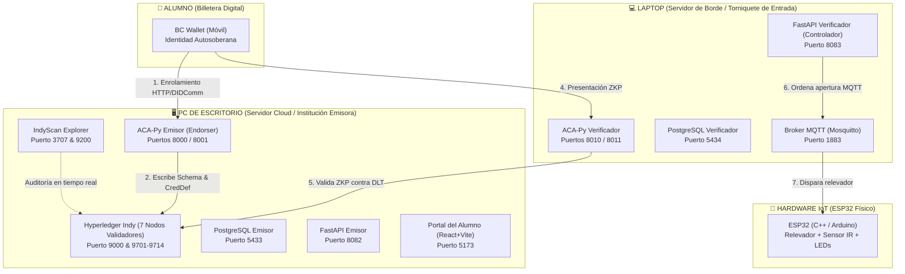

# Walkthrough: Arquitectura Distribuida SSI + IoT (BUAP)
## Guía de Despliegue con Delegación de Responsabilidades (PC de Escritorio + Laptop + ESP32)

Este documento describe la puesta en marcha de la tesis delegando las cargas arquitectónicas en **dos máquinas físicas independientes** y un **microcontrolador ESP32**, emulando el despliegue real de producción institucional. También se incluye la alternativa de ejecución monolítica (Todo-en-Uno) para pruebas rápidas.

---

## 1. Modelo de Delegación de Responsabilidades



---

## 2. Matriz de Componentes, Puertos e IPs de Red Local

Ambos equipos (PC y Laptop), el teléfono celular y el ESP32 deben estar conectados a la **misma red Wi-Fi o red local**.

> **Ejemplo de IPs en este instructivo:**
> - **IP de la PC de Escritorio:** `192.168.1.100`
> - **IP de la Laptop (Borde):** `192.168.1.150`
> - *(Reemplaza estas IPs con las que te asigne tu router mediante `ip a` o `hostname -I`)*.

| Dispositivo | Responsabilidad | Servicios y Contenedores | Puertos Expuestos |
| :--- | :--- | :--- | :--- |
| **PC de Escritorio** | **Infraestructura DLT** | `von-network` (Nodos 1 a 7, Webserver) | `9000`, `9701-9714` |
| | **Auditoría Blockchain** | `indyscan-webapp`, `api`, `daemon`, `es` | `3707`, `3708`, `3710`, `9200` |
| | **Emisor Universitario** | `postgres-db-emisor`, `fastapi-emisor` | `5433`, `8082` |
| | **Agente Criptográfico Emisor** | `acapy-emisor` (Rol Endorser) | `8000` (Inbound), `8001` (Admin) |
| | **Portal Web Estudiantil** | `react-frontend` | `5173` |
| **Laptop (Borde)** | **Broker de Mensajería IoT** | `mosquitto` (`ssi_mqtt_broker`) | `1883`, `9001` |
| | **Verificador de Borde** | `postgres-db-verificador`, `fastapi-verificador` | `5434`, `8083` |
| | **Agente Criptográfico Borde** | `acapy-verificador` | `8010` (Inbound), `8011` (Admin) |
| **ESP32** | **Actuador Físico Torniquete** | Firmware C++ (Relevador, IR, LEDs) | Conectado vía Wi-Fi a Mosquitto |
| **Smartphone** | **Billetera del Usuario** | BC Wallet App | Conectado vía Wi-Fi a los Agentes |

---

## ESCENARIO 1: Despliegue Distribuido (PC de Escritorio + Laptop + ESP32) [RECOMENDADO]

Este es el flujo principal para tu tesis, donde cada máquina asume su rol correspondiente.

---

### ETAPA A: En la PC de Escritorio (DLT + Emisor + Portal)

#### Paso A.1: Conocer la IP local de la PC
Abre una terminal en la PC de escritorio:
```bash
hostname -I | awk '{print $1}'
# Supongamos que devuelve: 192.168.1.100
```

#### Paso A.2: Levantar la Blockchain Indy y el Explorador IndyScan
Para que la Laptop y los teléfonos puedan comunicarse con los nodos de la blockchain, arrancamos `von-network` publicando la IP de la PC:
```bash
cd "/home/daniel/Escritorio/Tesis Codigo/codigo/infraestructura/scripts"

# 1. Iniciar von-network publicando la IP LAN
./start_indy_network.sh 192.168.1.100

# 2. Iniciar el explorador IndyScan
./start_indyscan.sh
```
- **Verificación:** Desde la PC o desde el navegador de la Laptop, entra a `http://192.168.1.100:9000` (deben verse los 7 nodos activos) y a `http://192.168.1.100:3707/home/LOCAL_NETWORK` (IndyScan).

#### Paso A.3: Registrar el DID Endorser del Emisor
1. Entra a `http://localhost:9000` (en la PC).
2. En la sección **Authenticate a New DID**:
   - **Wallet Seed:** `00000000000000000000000000000002`
   - **Alias:** `Institucion-Emisora`
   - **Role:** `ENDORSER`
3. Presiona **Register DID**. En *Domain Transactions* debe aparecer el DID `JDmZmbYJnRyz5mb5U9wCxK`.

#### Paso A.4: Levantar el Emisor Universitario y el Portal Web
En la terminal de la PC, ve a la raíz de `/codigo`:
```bash
cd "/home/daniel/Escritorio/Tesis Codigo/codigo"

# Levanta únicamente los servicios institucionales del Emisor y el Frontend
docker compose up -d postgres-db-emisor fastapi-emisor acapy-emisor react-frontend
```

#### Paso A.5: Inicializar el Esquema BUAP y la Definición de Credencial (CredDef)
Ejecuta la inicialización para registrar la credencial en la blockchain:
```bash
curl -s -X POST http://localhost:8082/setup/init-buap -H "Content-Type: application/json"
```
- **Salida esperada:**
  ```json
  {
    "message": "Inicialización exitosa",
    "schema_id": "JDmZmbYJnRyz5mb5U9wCxK:2:credencial-acceso-buap:1.0",
    "credential_definition_id": "JDmZmbYJnRyz5mb5U9wCxK:3:CL:...:default"
  }
  ```
- **Auditoría:** Abre IndyScan en `http://localhost:3707` y confirma que las transacciones `SCHEMA` y `CLAIM_DEF` aparezcan en el subledger de Dominio.

---

### ETAPA B: En la Laptop (Verificador de Borde + Mosquitto)

La Laptop actuará como el Gateway local del torniquete.

#### Paso B.1: Conocer la IP local de la Laptop
En la terminal de la Laptop:
```bash
hostname -I | awk '{print $1}'
# Supongamos que devuelve: 192.168.1.150
```

#### Paso B.2: Comprobar conectividad con la PC de Escritorio
Verifica que la Laptop pueda comunicarse con la blockchain de la PC:
```bash
curl -s http://192.168.1.100:9000/genesis | head -n 1
```
*(Debe responder inmediatamente con la primera línea del archivo génesis. Si no conecta, revisa el firewall en el Paso de Troubleshooting).*

#### Paso B.3: Levantar el Verificador de Borde y el Broker MQTT
En la Laptop, dentro de la carpeta `/codigo`:
```bash
cd "/home/daniel/Escritorio/Tesis Codigo/codigo"

# Levanta únicamente Mosquitto y los servicios del Verificador
# apuntando el génesis de ACA-Py a la PC de escritorio:
docker compose up -d mosquitto postgres-db-verificador fastapi-verificador acapy-verificador
```
> [!NOTE]
> Si la Laptop necesita indicarle a `acapy-verificador` la URL de génesis externa hacia la PC de escritorio, puedes ajustar la variable en el archivo de entorno o ejecutar:
> ```bash
> docker exec -it ssi_acapy_verificador bash -c "curl -s http://192.168.1.100:9000/genesis"
> ```

- **Verificación Verificador:** Abre en la Laptop `http://localhost:8083/docs` (Swagger del Verificador) y `http://localhost:8011/status` (ACA-Py Verificador).
- **Verificación MQTT:** El puerto `1883` debe estar activo escuchando en la Laptop.

---

### ETAPA C: En el ESP32 (Circuito Físico del Torniquete)

El microcontrolador físico se conectará por Wi-Fi al Broker Mosquitto que corre en la Laptop.

1. Abre el archivo [esp32_torniquete.ino](file:///home/daniel/Escritorio/Tesis%20Codigo/codigo/iot_hardware/esp32_torniquete.ino) en **Arduino IDE** en tu Laptop.
2. Modifica la configuración de conexión:
   ```cpp
   const char* WIFI_SSID     = "Tu_Red_WiFi";
   const char* WIFI_PASSWORD = "Tu_Password_WiFi";
   
   // La IP de la LAPTOP donde está corriendo Mosquitto
   const char* MQTT_BROKER_IP = "192.168.1.150"; 
   const int   MQTT_BROKER_PORT = 1883;
   ```
3. Conecta el ESP32 a la Laptop por USB y pulsa **Subir** (Upload).
4. Abre el **Monitor Serie** de Arduino IDE (`115200 baudios`):
   ```text
   [WiFi] Conectado exitosamente. IP: 192.168.1.180
   [MQTT] Conectado al broker Mosquitto de la Laptop!
   [MQTT] Suscrito a órdenes de apertura en: buap/torniquete/comandos
   >>> [ACTUADOR] 🔴 TORNIQUETE CERRADO / BLOQUEADO.
   ```
5. El circuito ya está armado con el relevador (`GPIO 26`), LED Rojo encendido (`GPIO 19`), LED Verde en espera (`GPIO 18`) y el Sensor Infrarrojo listo (`GPIO 27`).

---

### ETAPA D: Prueba de Extremo a Extremo (El Flujo Real de la Tesis)

Con todo el ecosistema distribuido en marcha:

#### 1. Emisión de la Credencial al Celular:
1. Conecta tu teléfono móvil a la misma red Wi-Fi.
2. En el navegador del teléfono abre el Portal del Alumno: `http://192.168.1.100:5173`.
3. Inicia sesión con la matrícula `20240001` y pulsa **"Generar Credencial SSI"**.
4. Abre **BC Wallet** en tu móvil y escanea el código QR mostrado en pantalla.
5. El Emisor enviará la oferta de credencial BUAP. Pulsa **Guardar Credencial**.

#### 2. Llegada al Torniquete y Validación ZKP:
1. El alumno llega al torniquete físico (Laptop + ESP32).
2. Se establece la conexión DIDComm entre BC Wallet y el Verificador de Borde (`acapy-verificador` en puerto `8010`).
3. Desde Swagger en la Laptop (`http://localhost:8083/docs`) o de forma automática, se dispara `POST /verificacion/solicitar` indicando la `cred_def_id`.
4. El teléfono móvil recibe la solicitud de prueba: **"Prueba de Acceso Universitario"**.
5. Al pulsar **Compartir**, BC Wallet envía la prueba matemática ZKP al Verificador.
6. El Verificador consulta la firma en la blockchain Indy de la PC (`192.168.1.100`), confirma la validez (`verified=True`) y publica en Mosquitto:
   ```json
   {"accion": "abrir", "pres_ex_id": "..."}
   ```
7. **El ESP32 recibe el mensaje por Wi-Fi al instante:**
   - Escucharás el *clic* del relevador abriendo el circuito.
   - El LED Rojo se apaga y el LED Verde enciende con un *beep* del Buzzer.
   - Cuando pasas la mano por el sensor infrarrojo (simulando cruzar el torniquete), el ESP32 cierra el relevador de inmediato (`🔴 CERRADO`) y envía el mensaje de telemetría anti-tailgating por MQTT.

---

## ESCENARIO 2: Despliegue Todo-en-Uno (Solo en la PC de Escritorio)

Si no tienes la Laptop a mano y deseas depurar o demostrar todo el flujo en una sola computadora:

### 1. Iniciar Blockchain e IndyScan en la PC:
```bash
cd "/home/daniel/Escritorio/Tesis Codigo/codigo/infraestructura/scripts"
./start_indy_network.sh
./start_indyscan.sh
```

### 2. Registrar el DID Endorser en `http://localhost:9000`:
- Seed: `00000000000000000000000000000002` con rol `ENDORSER`.

### 3. Levantar la Orquestación Completa con Docker Compose:
Desde `/codigo`:
```bash
cd "/home/daniel/Escritorio/Tesis Codigo/codigo"
docker compose up -d --build
```
*(Levanta Mosquitto, Emisor BD/API/ACA-Py, Verificador BD/API/ACA-Py y Frontend).*

### 4. Inicializar Esquema:
```bash
curl -X POST http://localhost:8082/setup/init-buap
```

### 5. Correr el Simulador de Hardware en Python:
Abre una terminal dedicada:
```bash
cd "/home/daniel/Escritorio/Tesis Codigo/codigo/iot_hardware"
python simulador_torniquete.py
```
*(Escuchará en `localhost:1883` y actuará como el ESP32 virtual simulando aperturas y telemetría).*

---

## 3. Guía de Diagnóstico y Ajustes de Red (Troubleshooting)

### A. Si la Laptop no puede conectarse a la PC de Escritorio
- **Causa:** El Firewall de Linux (UFW) en la PC de escritorio puede estar bloqueando las conexiones entrantes.
- **Solución:** En la PC de escritorio, permite el tráfico de la red local:
  ```bash
  # Permitir puertos de Indy, IndyScan, Emisor y Frontend
  sudo ufw allow from 192.168.1.0/24 to any port 9000 proto tcp
  sudo ufw allow from 192.168.1.0/24 to any port 9701:9714 proto tcp
  sudo ufw allow from 192.168.1.0/24 to any port 8000:8002 proto tcp
  sudo ufw allow from 192.168.1.0/24 to any port 5173 proto tcp
  sudo ufw allow from 192.168.1.0/24 to any port 3707 proto tcp
  ```

### B. Si el ESP32 no se conecta a Mosquitto en la Laptop
- **Causa:** El puerto 1883 en la Laptop no está accesible o la configuración de Mosquitto no permite conexiones anónimas remotas.
- **Solución:** Verifica que el archivo `iot_hardware/mosquitto.conf` contenga:
  ```text
  listener 1883
  allow_anonymous true
  ```
  Y en la Laptop permite el puerto en el firewall:
  ```bash
  sudo ufw allow 1883/tcp
  ```

### C. Si el teléfono móvil (BC Wallet) no carga el QR
- **Causa:** El endpoint del agente ACA-Py debe contener la IP real accesible en la red Wi-Fi y no `localhost`.
- **Solución:** En `codigo/docker-compose.yml`, en el servicio `acapy-emisor`, cambia `--endpoint http://localhost:8000` por `--endpoint http://192.168.1.100:8000`.

### D. Comandos de Inspección Rápida
```bash
# Ver estado de todos los contenedores
docker ps --format "table {{.Names}}\t{{.Status}}\t{{.Ports}}"

# Monitorear logs del Verificador de Borde en la Laptop
docker logs -f ssi_fastapi_verificador

# Monitorear mensajes en el broker MQTT desde la terminal
docker exec -it ssi_mqtt_broker mosquitto_sub -t "buap/#" -v
```
